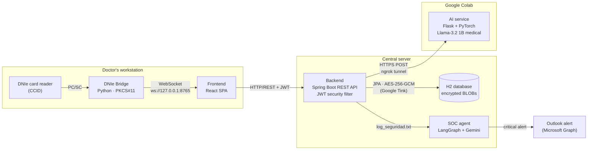

# AI-Assisted Medical Consultation Platform

Secure web platform for clinical record management with AI-assisted diagnosis, encryption of clinical data at rest, electronic ID card (DNIe) patient identification and an autonomous cybersecurity agent.

Bachelor's thesis (TFG) in Telematics Engineering, University of Jaén. Original title: *Implementación de una plataforma web para el seguimiento de pacientes para el parametrizado y extracción de información médica para LLM*.

## Overview

Doctors manage their daily schedule, open a patient's record by inserting the patient's Spanish electronic ID card into a reader, and register consultations (anamnesis, diagnosis, treatment). The platform suggests medical terms while the doctor writes, finds similar past cases by keywords, and requests a second diagnostic opinion from a medical LLM. Doctors can then rate that opinion so it can be used to improve the model later.

Security and privacy are built into the design for GDPR compliance:

- Stateless authentication with JWT and role-based access control
- AES-256-GCM encryption of clinical fields in the database
- Non-sequential UUIDv7 identifiers
- An AI security agent that monitors the backend's security log in real time

## Architecture



| Module | Location | Technologies |
|---|---|---|
| Backend | repository root (`src/`) | Java 17, Spring Boot 4, Spring Security, Spring Data JPA, H2, jjwt, Google Tink |
| Frontend | [`frontend/`](frontend) | React 19, React Router, Axios, FullCalendar, jwt-decode |
| AI service | [`ia-service/`](ia-service) | Python, Flask, Hugging Face Transformers, PyTorch, pyngrok |
| SOC agent | [`soc-agent/`](soc-agent) | Python, LangGraph, Gemini 2.5 Flash, O365 (Microsoft Graph) |
| DNIe Bridge | [`dnie-bridge/`](dnie-bridge) | Python, PyKCS11, websockets, asyncio |
| Deployment | [`Dockerfile`](Dockerfile), [`infra/terraform/`](infra/terraform) | Docker, Docker Compose, Terraform, AWS (EC2, SSM) |

## Features

**Clinical workflow**
- Daily appointment calendar per doctor, with drag-and-drop rescheduling and cancellation.
- Automatic patient identification with an electronic ID card reader, plus manual search by ID number.
- Consultation records with anamnesis, diagnosis and treatment, plus the full history per patient.
- Real-time medical term autocompletion ("ghost layer"); accepted terms are stored as keywords.
- Similar-case search that returns past consultations sharing at least three keywords.
- Second diagnostic opinion from `ContactDoctor/Bio-Medical-Llama-3-2-1B-CoT-012025`, using chain-of-thought prompting, with a 1–5 star rating and comments from the doctor.
- Administrator panel to list, create and delete doctor accounts.

**Security and privacy**
- Stateless JWT (HMAC-SHA256) authentication with `ADMIN` and `USER` roles enforced by Spring Security.
- Clinical fields encrypted with AEAD (AES-256-GCM) through Google Tink and decrypted only in memory.
- Time-ordered UUIDv7 identifiers for patients and doctors, which prevent enumeration attacks.
- Input validation through DTOs; every validation failure is logged with timestamp and source IP.
- SOC agent that tails the security log, structures each event as JSON (a basic SIEM) and emails the administrator when it detects recurring attacks.
- The DNIe bridge reads only the public document number. It never requests PINs or uses signing certificates.

## Repository structure

```
.
├── src/main/java/com/example/demo/   Spring Boot backend
├── src/main/resources/static/        Compiled React frontend (served by the backend)
├── frontend/                         React source code
├── ia-service/                       AI diagnostic service (Google Colab)
├── soc-agent/                        Autonomous SOC agent
├── dnie-bridge/                      Local DNIe reader bridge
├── infra/terraform/                  AWS infrastructure as code
├── Dockerfile                        Container image for backend + frontend
├── docker-compose.yml
└── pom.xml
```

## Getting started

### 1. Backend and frontend

Requirements: JDK 17 or later. Maven is not required; use the included wrapper (`mvnw`).

**Keys.** They are not included in the repository. By default the application looks for them in `claves/`, which is ignored by git:

| File | Purpose |
|---|---|
| `claves/tink_keyset.json` | AES-256-GCM master key for clinical data |
| `claves/jwt_secret.key` | HS256 key for signing JWT tokens |

To create them, uncomment and run `GeneradorClaves` and `Generador_clave_token_firma` once (in that order), then comment them out again. The JWT key can also be generated with `openssl rand -out claves/jwt_secret.key 32`.

**Configuration.** The following environment variables override `application.properties`:

| Variable | Description | Default |
|---|---|---|
| `RUTA_CLAVE_MAESTRA` | Path to the Tink keyset | `./claves/tink_keyset.json` |
| `RUTA_CLAVE_JWT` | Path to the JWT key | `./claves/jwt_secret.key` |
| `IA_URL` | AI service endpoint (ngrok URL) | `https://xxxx.ngrok-free.dev/ia/generar-respuesta` |

**Run:**

```bash
./mvnw spring-boot:run        # Linux / macOS
mvnw.cmd spring-boot:run      # Windows
```

The application is then available at <http://localhost:8081>. The backend also serves the compiled frontend, so Node.js is not needed just to run the application.

To work on the frontend, see [`frontend/README.md`](frontend/README.md): `npm start` runs a development server on port 3000 that forwards API calls to the backend.

### 2. AI service (Google Colab)

1. Open a new notebook in Google Colab with a GPU runtime.
2. In **Secrets** (the key icon in the sidebar), add `HF_TOKEN` (Hugging Face access token) and `NGROK_AUTHTOKEN` (ngrok authtoken), and grant the notebook access to them.
3. Install the dependencies in one cell: `!pip install flask pyngrok flask-cors nest_asyncio`
4. Paste the contents of [`ia-service/ia_service.py`](ia-service/ia_service.py) into another cell and run it.
5. Copy the printed URL into the backend's `IA_URL` setting.

### 3. SOC agent

```bash
cd soc-agent
pip install -r requirements.txt
cp Rutas.example.txt Rutas.txt     # then fill in your keys
python agente_soc.py
```

The agent needs a Google AI Studio API key and an app registration in Microsoft Entra ID (client ID and client secret) that supports personal Microsoft accounts and uses `http://localhost:8000` as the redirect URI. The first run asks you to sign in to Outlook.

### 4. DNIe Bridge (Windows)

Requirements: a CCID smart card reader and the official DNIe PKCS#11 module (`DNIe_P11_x64.dll`) from the Spanish National Police.

```bash
cd dnie-bridge
pip install -r requirements.txt
python puente_dnie.py
```

The bridge listens on `ws://127.0.0.1:8765`. When a card is inserted, the dashboard opens that patient's record automatically.

## Deployment

> These deployment files follow the design described in the thesis. They have been statically validated (Terraform syntax and a Checkov security scan of the Terraform code and the Dockerfile), but they have not been tested in a real deployment.

The backend serves the compiled React frontend, so the whole web application is a single container on port 8081. The AI service stays on Colab and the DNIe bridge runs on each doctor's workstation.

### Docker

The image uses a multi-stage build (Maven → JRE 17), runs as a non-root user and disables the H2 console. Keys are never copied into the image; they are mounted read-only at runtime.

```bash
mkdir -p claves logs                 # put tink_keyset.json and jwt_secret.key in claves/
cp .env.example .env                 # optional: set IA_URL
docker compose up -d --build
```

The H2 database is kept in a named volume (`h2-data`). The security log is written to `./logs/log_seguridad.txt`, so the SOC agent can read it from the host by setting `RUTA_LOGS=../logs/log_seguridad.txt` in its `Rutas.txt`. On Linux, give the container user write access to the logs folder with `sudo chown 10001:10001 logs`.

### AWS with Terraform

[`infra/terraform/`](infra/terraform) provisions the server sized in the thesis budget: an EC2 `t3.medium` in an EU region, running the container.

- **Network:** the application is reachable only from an authorised IP range (`allowed_cidr`; `0.0.0.0/0` is rejected), and outbound traffic is limited to HTTP/HTTPS.
- **Administration:** there is no SSH port. The instance is managed with AWS Systems Manager Session Manager.
- **Keys:** they are stored as `SecureString` parameters in SSM Parameter Store, never in the repository or the Terraform state. The instance role can read only the project's parameters.
- **Hardening:** IMDSv2 is required, the root disk (which holds the H2 database) is encrypted, and the instance has a fixed Elastic IP.

**1. Upload the keys to SSM** (once, with the AWS CLI):

```bash
aws ssm put-parameter --region eu-west-3 --type SecureString \
  --name /tfg-medical/tink_keyset --value file://claves/tink_keyset.json
aws ssm put-parameter --region eu-west-3 --type SecureString \
  --name /tfg-medical/jwt_secret_b64 --value "$(base64 -w0 claves/jwt_secret.key)"
```

**2. Deploy:**

```bash
cd infra/terraform
cp terraform.tfvars.example terraform.tfvars   # set allowed_cidr to your IP/32
terraform init
terraform plan
terraform apply
```

The `app_url` output gives the application address. On first boot the instance clones this repository and builds the image, which takes a few minutes. Run `terraform destroy` to remove everything.

**Production notes.** HTTPS is not configured; a real deployment would put the application behind a load balancer or reverse proxy with a TLS certificate. H2 would be replaced by a managed database such as Amazon RDS. The demo administrator account (`admin` / `1234`) must be removed before exposing the service.

## Demo data and credentials

On startup the backend loads four fictitious patients and their appointments for the current day.

| Username | Password | Role |
|---|---|---|
| `admin` | `1234` | Administrator |

The local H2 database uses `sa` / `123`, and its console is at `/h2-console`.

> **Warning:** these credentials, the open H2 console and the preloaded data exist only for the thesis demo. They must not be used in a real deployment.

## API overview

| Method | Endpoint | Role | Description |
|---|---|---|---|
| POST | `/api/auth/login` | public | Log in and receive a JWT |
| GET | `/api/reservas/agenda` | user | Today's appointments |
| PATCH | `/api/reservas/{id}` | user | Reschedule an appointment |
| PATCH | `/api/reservas/{id}/cancelar` | user | Cancel an appointment |
| GET | `/api/pacientes/{dni}` | user | Find a patient by ID number |
| POST | `/api/citas` | user | Register a consultation |
| GET | `/api/citas/historial/{dni}` | user | Consultation history of a patient |
| GET | `/api/citas/buscar-similares` | user | Similar cases by keywords |
| POST | `/api/ia/generar-respuesta` | user | Request the AI second opinion |
| GET | `/api/admin/medicos` | admin | List doctors |
| POST | `/api/admin/medicos/guardar` | admin | Create a doctor |
| DELETE | `/api/admin/medicos/{id}` | admin | Delete a doctor |

## Limitations and future work

- The 1B-parameter model can hallucinate. Larger models (8B/70B) and fine-tuning on anonymised oncology records would need dedicated GPU infrastructure.
- The frontend stores the JWT in `localStorage`; moving it to an `HttpOnly` + `Secure` cookie would mitigate XSS.
- Doctor passwords are stored in plain text in this prototype; they should be hashed with BCrypt.
- The AI service runs on Colab behind a temporary ngrok URL that changes on every run.

## Notes

The source code, comments and user interface are written in Spanish. This is an academic prototype and not a certified medical device: AI output is a suggestion for the doctor to review, never a diagnosis.

## Authors

- Francisco Sánchez Orozco
- Sebastián Zamora Molina

Supervised by Juan Carlos Cuevas Martínez and Raquel Viciana Abad, Department of Telecommunication Engineering, University of Jaén.
